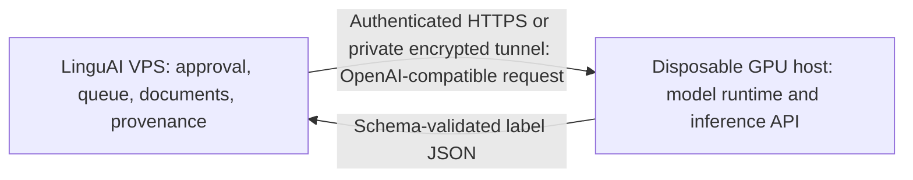

# Teacher service boundary

The control plane is the system of record. The GPU service must not connect to the VPS PostgreSQL database, HF source datasets, artifact storage or unrelated APIs. It receives one bounded request and returns one response. The caller persists attempts, teacher/profile/prompt versions, document hash and accepted labels.

## Request and response

The existing client sends `POST {TEACHER_BASE_URL}/chat/completions`; deployment config uses a base URL ending in `/v1`. The body contains `model`, `temperature: 0` and two messages: the complete versioned system prompt, followed by the exact user template filled with document ID and teacher sketch. It does not send the source dataset name. If configured, the caller sends `Authorization: Bearer ...`.

The response must preserve the OpenAI-compatible envelope and place a string in `choices[0].message.content`. That string must parse as exactly one object accepted by `teacher_label_v1.schema.json`, with the request ID. The service must parse and validate independently even if the selected backend can constrain JSON generation. No comments, Markdown fence, explanation, reasoning, routing or provenance fields may appear in the label object. A model response with a different ID fails; the service must never overwrite the generated ID.

## Trust and data handling

- Treat document text as untrusted prompt content; keep its delimiters/template unchanged.
- Authenticate the VPS caller and use HTTPS or a private encrypted tunnel. Do not expose unauthenticated inference on a public port. Jupyter/SSH access is an operator channel, not the API endpoint.
- Do not write request bodies, prompt text, completion bodies, API keys or document content to operational logs, traces, metrics labels or notebook output. Correlate with redacted request IDs only.
- Enforce measured request-byte/token bounds before GPU execution. Reject oversized/malformed requests without echoing content.
- Keep model artifacts/cache off Git. Pin model revision and runtime dependencies; store no VPS data on replaceable GPU disks.

## Runtime lifecycle

Liveness indicates that the serving process responds. Readiness is false until the selected model is fully loaded, API auth and schema validator are configured, and a bounded non-labeling check passes. A health probe must never run a document label. Model loading/OOM leaves readiness false. Bound active generation concurrency from measured VRAM including KV cache and overhead. On host/network loss, return a controlled error; the VPS retains and retries the job according to its own attempt policy.

## Latency and provenance

The current control-plane HTTP timeout is 20 seconds. Its claim lease is 60 seconds and heartbeat freshness is 30 seconds. Measure total request latency at the VPS, including prompt processing and generation. If timing needs changes, update and test these interacting control-plane limits before relying on the new GPU profile. The service must expose the selected model ID through standard API metadata or an equivalent readiness detail and deployment records must pin the resolved model revision and serving image/version. The application records provenance; do not add provenance to teacher JSON.

## Not chosen yet

This boundary intentionally does not prescribe Python framework, API framework, CUDA image, model, quantization or serving engine. Select them only after actual GPU inspection, contract support checks and model memory/latency tests. Record versions and rationale in a dated ADR before implementation.
